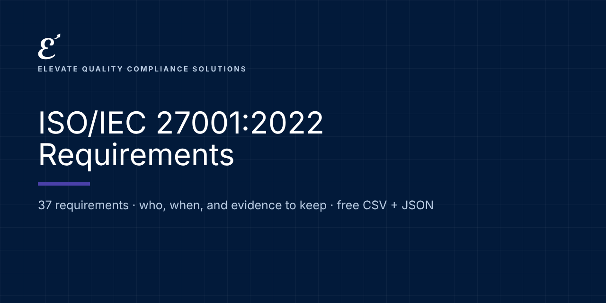

# ISO/IEC 27001:2022: Requirements and Evidence

   

**Free, machine-readable ISO/IEC 27001:2022 requirements in plain language: who each one applies to, when it applies, and examples of the evidence to keep.** CSV and JSON, ready for Excel, Google Sheets, GRC tools or your own code.

Maintained by [Elevate Quality Compliance Solutions](https://elevateqcs.com). If this saves you time, please ⭐ star the repo so others can find it.

**Source:** ISO/IEC 27001:2022 (with Amendment 1:2024) Information security management systems. Clause and Annex A group references with our own summaries; no ISO text reproduced.
**Official text:** https://www.iso.org/standard/27001

## Key dates
| Date | What applies |
|---|---|
| 2022-10-25 | ISO/IEC 27001:2022 published |
| 2024-02 | Amendment 1: climate change considerations |
| 2025-10-31 | End of transition from the 2013 edition |

## How to use it (2 minutes)
1. **Browse online:** [https://elevate-qcs.github.io/iso-27001-2022-requirements/](https://elevate-qcs.github.io/iso-27001-2022-requirements/) and search or filter.
2. **Spreadsheet:** download [`data/requirements.csv`](data/requirements.csv), open it in Excel or Google Sheets, and add columns for status, owner and evidence location. That's your gap assessment.
3. **Code and GRC tools:** load [`data/requirements.json`](data/requirements.json) (format: [`schema/`](schema/requirement.schema.json); examples: [`examples/`](examples/)).

Full guide: [docs/HOW-TO-USE.md](docs/HOW-TO-USE.md) · [FAQ](docs/FAQ.md)

## Requirements (37)
Applies to: organization

| Reference | Requirement | Applies to | From | Evidence examples |
|---|---|---|---|---|
| 4.1 | **Understanding the organization and its context**: Know the internal and external issues relevant to information security, including whether climate change is relevant (Amendment 1). | organization | Certifiable | Context register and climate determination. |
| 4.2 | **Interested parties**: Identify interested parties, their requirements, and which are addressed through the ISMS. | organization | Certifiable | Interested-party register. |
| 4.3 | **Scope of the ISMS**: Define ISMS boundaries, interfaces and dependencies. | organization | Certifiable | ISMS scope (documented information). |
| 4.4 | **Information security management system**: Establish the ISMS and the processes it needs. | organization | Certifiable | ISMS manual or equivalent description. |
| 5.1 | **Leadership and commitment**: Top management directs and supports the ISMS and integrates it into business processes. | organization | Certifiable | Management commitment, review minutes, resources. |
| 5.2 | **Policy**: Set an information security policy with objectives framework and commitments. | organization | Certifiable | Approved policy (documented information), communicated. |
| 5.3 | **Roles, responsibilities and authorities**: Assign and communicate ISMS responsibilities. | organization | Certifiable | RACI and appointments. |
| 6.1.2 | **Information security risk assessment**: Define and apply a repeatable risk assessment process: identify, analyze and evaluate risks with owners. | organization | Certifiable | Risk assessment process and results (documented information). |
| 6.1.3 | **Risk treatment and Statement of Applicability**: Choose treatment options and controls, compare with Annex A, produce the Statement of Applicability and treatment plan, and get risk owners' approval. | organization | Certifiable | Statement of Applicability, risk treatment plan, risk acceptance (documented information). |
| 6.2 | **Information security objectives**: Set measurable objectives and plan to achieve them. | organization | Certifiable | Objectives and plans (documented information). |
| 6.3 | **Planning of changes**: Plan ISMS changes in a controlled way. | organization | Certifiable | Change records. |
| 7.1–7.3 | **Resources, competence and awareness**: Provide resources, ensure competence and make everyone aware of the policy and their role. | organization | Certifiable | Competence and training records (documented evidence). |
| 7.4 | **Communication**: Decide what, when, with whom and how to communicate about information security. | organization | Certifiable | Communication plan and records. |
| 7.5 | **Documented information**: Control ISMS documents and records. | organization | Certifiable | Document register, approvals, retention. |
| 8.1 | **Operational planning and control**: Plan and control the processes needed, including externally provided ones. | organization | Certifiable | Evidence processes run as planned. |
| 8.2–8.3 | **Risk assessment and treatment in operation**: Repeat risk assessments at planned intervals or on significant change, and implement the treatment plan. | organization | Certifiable | Updated risk assessment results and treatment status (documented information). |
| 9.1 | **Monitoring, measurement, analysis and evaluation**: Decide what to measure and evaluate ISMS performance and effectiveness. | organization | Certifiable | Metrics results (documented evidence). |
| 9.2 | **Internal audit**: Run an audit program and report results. | organization | Certifiable | Audit program and reports (documented evidence). |
| 9.3 | **Management review**: Top management reviews the ISMS with all required inputs. | organization | Certifiable | Review minutes (documented evidence). |
| 10.1 | **Continual improvement**: Continually improve the ISMS. | organization | Certifiable | Improvement actions. |
| 10.2 | **Nonconformity and corrective action**: React, find causes, act and verify effectiveness. | organization | Certifiable | Nonconformity and corrective action records. |
| A.5.1–A.5.4 | **Policies, roles, segregation, management duties**: Information security policy set, roles assigned, conflicting duties separated, managers enforce rules. | organization | Certifiable | Policies approved and acknowledged; RACI. |
| A.5.5–A.5.8 | **Authorities, special interest groups, threat intelligence, projects**: Keep contacts with authorities and groups, collect threat intelligence, and build security into projects. | organization | Certifiable | Contact list, threat intelligence records, project security checks. |
| A.5.9–A.5.14 | **Assets, classification, labeling and information transfer**: Inventory assets, classify and label information, and protect it in transfer. | organization | Certifiable | Asset inventory, classification scheme, transfer agreements. |
| A.5.15–A.5.18 | **Access control and identity**: Control access by business need, manage identities, authentication and access rights. | organization | Certifiable | Access requests, periodic access reviews, joiner/mover/leaver records. |
| A.5.19–A.5.23 | **Suppliers and cloud services**: Manage security in supplier relationships, contracts, the ICT supply chain and cloud services. | organization | Certifiable | Supplier assessments, contract clauses, monitoring records. |
| A.5.24–A.5.28 | **Incident management**: Plan, assess, respond to and learn from incidents; collect evidence. | organization | Certifiable | Incident reports, lessons learned, exercise records. |
| A.5.29–A.5.30 | **Continuity and ICT readiness**: Maintain security during disruption and ensure ICT readiness for continuity. | organization | Certifiable | Continuity plans, test records. |
| A.5.31–A.5.37 | **Legal, IP, records, privacy, independent review, compliance, procedures**: Meet legal and contractual requirements, protect records and personal data, review security independently, document operating procedures. | organization | Certifiable | Legal register, privacy records, independent review results, operating procedures. |
| A.6.1–A.6.8 | **People controls**: Screening, terms of employment, awareness, discipline, leaving, confidentiality agreements, remote working and event reporting. | organization | Certifiable | Screening records, signed terms and NDAs, training records, leaver checklists. |
| A.7.1–A.7.14 | **Physical controls**: Secure perimeters, entry, offices, equipment, clear desk and screen, storage media and secure disposal. | organization | Certifiable | Physical access records, disposal records. |
| A.8.1–A.8.5 | **Endpoints, privileged access, access restriction, authentication**: Protect user devices, restrict privileged rights and source code, and use secure authentication. | organization | Certifiable | Device inventory, privileged access reviews, MFA configuration. |
| A.8.7–A.8.9 | **Malware, vulnerabilities, configuration**: Protect against malware, manage technical vulnerabilities and secure configurations. | organization | Certifiable | Patch records, vulnerability scans, configuration baselines. |
| A.8.10–A.8.14 | **Deletion, masking, data leakage, backup, redundancy**: Delete data when no longer needed, mask where required, prevent leakage, back up and provide redundancy. | organization | Certifiable | Deletion records, backup and restore test results. |
| A.8.15–A.8.17 | **Logging, monitoring and clock synchronization**: Produce and protect logs, monitor for anomalies and synchronize clocks. | organization | Certifiable | Log configuration, monitoring alerts and reviews. |
| A.8.20–A.8.24 | **Network security and cryptography**: Secure and segregate networks, filter web access and use cryptography properly. | organization | Certifiable | Network diagrams, firewall rules review, key management records. |
| A.8.25–A.8.34 | **Secure development, testing and change**: Secure development life cycle, testing, outsourced development, environment separation and change management. | organization | Certifiable | Secure coding standards, test results, change records. |

## Implementation kit (launching soon)
This repository tells you **what** is required. Our ISO/IEC 27001:2022 implementation kit gives you **ready-to-adapt documents** to do it: policies, procedures, forms, workbooks, a Kit Navigator and training, mapped to these requirements.
**[Join the launch list](https://elevateqcs.com/coming-soon)** to be notified.

## Disclaimer
This repository is general information to help you understand and organize work on AI governance frameworks. It is not legal advice and does not guarantee compliance, certification or any regulatory outcome. Requirements are summarized in our own words; always check the official texts and get qualified advice for your situation. ISO and IEC standards are copyrighted: we reference clause numbers with our own summaries and never reproduce their text. Buy the standard from ISO, IEC or your national standards body.

## Corrections and contributions
Spotted an error or a change? [Open a correction](../../issues/new?template=correction.md) with a link to the official source. See [CONTRIBUTING.md](CONTRIBUTING.md).

## Reuse and citation
Free under [CC BY 4.0](LICENSE), including commercially, with credit: *"ISO/IEC 27001:2022 Requirements by Elevate Quality Compliance Solutions (elevateqcs.com)"*. See [CITATION.cff](CITATION.cff).

## More open requirements from ElevateQCS
[ISO 9001:2026](https://github.com/elevate-qcs/iso-9001-2026-requirements) · [ISO 14001:2026](https://github.com/elevate-qcs/iso-14001-2026-requirements) · [NIS2](https://github.com/elevate-qcs/nis2-requirements) · [DORA (Financial Entities)](https://github.com/elevate-qcs/dora-financial-entities-requirements) · [DORA (ICT Providers)](https://github.com/elevate-qcs/dora-ict-providers-requirements) · [EU AI Act](https://github.com/elevate-qcs/eu-ai-act-requirements) · [ISO/IEC 42001](https://github.com/elevate-qcs/iso-42001-requirements) · [NIST AI RMF](https://github.com/elevate-qcs/nist-ai-rmf-requirements) · [GDPR for AI](https://github.com/elevate-qcs/gdpr-ai-requirements)
